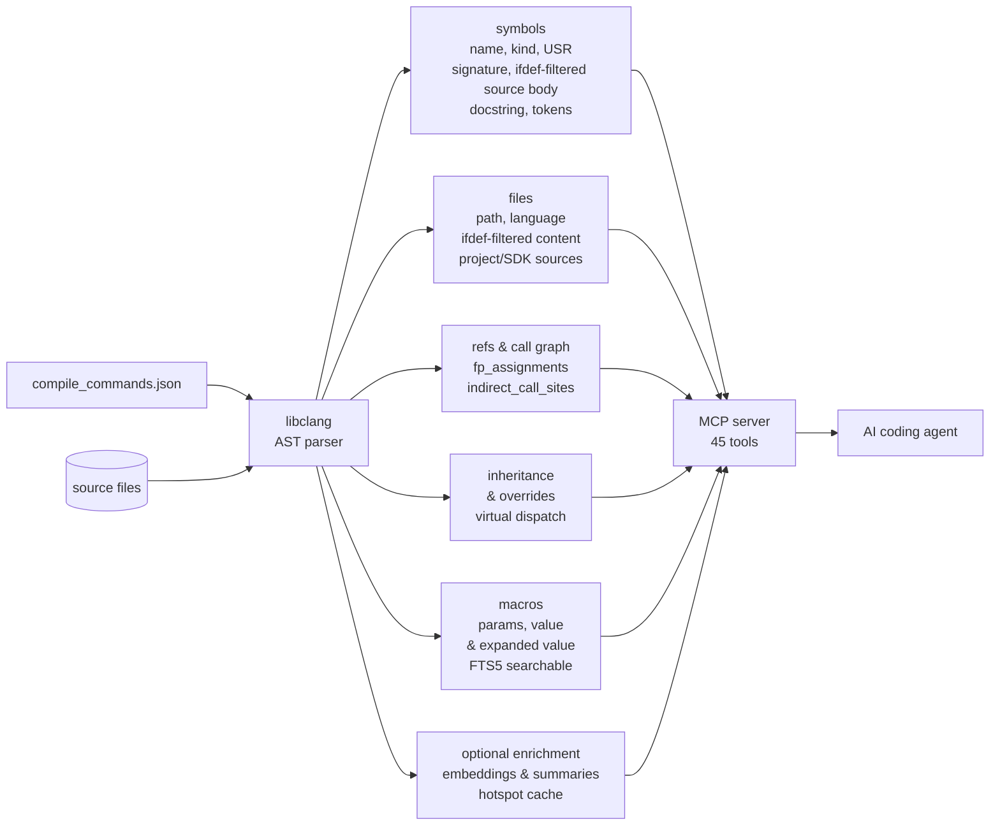

<!-- mcp-name: io.github.turbyho/fw-context-mcp -->

# fw-context

**Build-aware code intelligence for AI coding agents working on embedded C and C++ firmware.**


-green)

fw-context builds a persistent semantic index from `compile_commands.json` and the libclang AST, then exposes it to coding agents through MCP. Instead of reconstructing your firmware through repeated file reads and text searches, the agent can query the program structure that one build produces.

It helps agents answer questions such as:

- Which implementation is active in this build?
- Who calls this function, directly or indirectly?
- Where is this callback registered?
- Which function-pointer assignments can reach this call site?
- Which code is excluded by preprocessing?
- What will be affected if this API changes?
- How does execution flow from an ISR to application code?

The goal is not to give the model more source code. It is to give it the **smallest useful, build-aware context** needed for the current task.

## Key features

- **Compiler-derived, not heuristic** — the index comes from the same `compile_commands.json` your build produces and libclang's AST, so what the agent sees is what the compiler builds.
- **Preprocessor-aware** — inactive `#ifdef` branches are excluded; `explain_condition` can tell you *why* a line is or is not compiled.
- **Full call graph, including indirect calls** — function-pointer assignments, callback registrations, ISR entry points and recursive caller/callee paths.
- **C++ OOP aware** — inheritance chains, virtual overrides, template instantiations and class member inventories.
- **Multi-variant and multi-image** — one project, several boards/targets; index them side by side and compare what differs per symbol or per build.
- **Vendor/SDK separation** — project code and SDK code are indexed and classified separately, so queries can scope to what you own.
- **Local-first** — source code and the index stay on your machine; Ollama integration is optional and also local.
- **Persistent and incremental** — the index lives in SQLite; after the first build, only changed translation units are reprocessed.

## Results from a real firmware review

In the included [firmware review case study](docs/examples/firmware-review/), fw-context was used on an nRF52/Mbed OS project containing approximately 67,000 lines of C and C++:

- 115 changed files reviewed by 8 parallel subagents
- 19 findings across memory safety, concurrency, API use and dead code
- 9 findings that depended on semantic relationships not available from ordinary text search alone
- approximately 54,000 context tokens used by fw-context queries
- an estimated 5.8 million tokens for the equivalent broad `grep` and file-reading workflow

The case study includes the review output, methodology and per-tool token analysis so the claims can be inspected rather than treated as a black-box benchmark.

## Quick start

### Prerequisites

- Python 3.11 or newer
- libclang
- a project that can produce `compile_commands.json`
- an MCP-capable coding agent such as Claude Code or OpenCode

Ollama is optional for the core index: symbols, full-text search, call graph and source come from libclang and SQLite only. With the default configuration, Ollama also computes the vector embeddings (`semantic_search`, the re-rank step of `smart_search`) and the symbol analysis (`explain_symbol`, symbol descriptions). Without Ollama, these features fall back to full-text search or return raw prompts, and the status tools tell you that the embeddings are not complete. When you use no embedding model and no LLM, set `[llm] enabled = false`. See [Ollama](docs/installation.md#ollama-optional).

### Install via pip (recommended)

```bash
pip install fw-context-mcp
```

### Install the current source version

```bash
git clone https://github.com/hyh9335/fw-context-mcp.git ~/.fw-context/src
cd ~/.fw-context/src
make install
```

Register fw-context with the supported coding agents detected in your project:

```bash
cd /path/to/your/firmware
fw-context init
```

Build and index the firmware:

```bash
cd /path/to/your/firmware
fw-context index --build
```

Then restart the coding agent and ask it questions about the project. The index is persistent and incremental; after the initial run, changed translation units are reprocessed instead of rebuilding the entire index.

See the [Quick Start](docs/README.md) and [Installation Guide](docs/installation.md) for platform-specific setup.

## Supported build systems

fw-context detects the build system, generates (or converts) `compile_commands.json`, and can drive the build itself:

| Build system | Automatic build | Notes |
|---|---|---|
| Mbed OS | yes | `mbed compile`, target/toolchain from `.mbed` |
| PlatformIO | yes | `PLATFORMIO_BUILD_DIR` override |
| Zephyr (west) | yes | incl. sysbuild and multi-image |
| ESP-IDF | yes | `idf.py -B`, `idf_path` auto-detected |
| Arduino (arduino-cli) | yes | FQBN required |
| Generic CMake | yes | `cmake -B <out>` |
| Makefile | generate | dry-run via `compiledb`, no real compilation |
| Keil MDK | convert | `*.uvprojx` → `compile_commands.json` |
| IAR EWARM | convert | `*.ewp` → `compile_commands.json` |
| STM32CubeIDE, TI CCS | — | export/convert externally |
| Manual / bare | generate | scan dirs + flags in `config.toml` |

Multi-variant projects (`[[build.variants]]`) index several boards or targets from one codebase; Zephyr sysbuild images are supported natively. See the [build guide](docs/build.md) for the full configuration reference and worked examples for every system.

## The 45 MCP tools

Your AI assistant calls these over JSON-RPC (stdio). Grouped by purpose:

### Status and lifecycle

| Tool | What it answers |
|---|---|
| `get_active_build` | Index health; call at session start |
| `get_project_status` | Which builds exist, which one a query hits |
| `get_build_info` | One build's facts, kinds, coverage counters |
| `get_build_health` | Per-build indexed-state report |
| `get_environment_status` | Complete project environment in one call |
| `list_projects` | All indexed firmware projects |
| `get_project_info` | Project metadata from the global registry |
| `list_variants` | Indexed variants and images |
| `check_ollama` | Ollama availability probe |
| `configure_llm` | Write per-developer LLM settings (`local.toml`) |
| `check_dependencies` | Read-only dependency audit of the installation |
| `reindex_file` | Re-index a single file after editing |
| `reset_index` | Delete the index (dry-run first) |

### Search

| Tool | What it answers |
|---|---|
| `search_code` | Full-text search, FTS5 syntax |
| `search_bodies` | Patterns inside definitions only |
| `search_content` | Patterns across full file content (ifdef-filtered) |
| `lookup_symbol` | Symbol by exact or prefix name |
| `smart_search` | Natural language → keywords (LLM) + FTS5 + optional vector re-rank |
| `semantic_search` | Concept search over symbol embeddings |
| `find_variables` | Variables by name; who reads/writes them |

### Source reading

| Tool | What it answers |
|---|---|
| `get_file_map` | Structural overview of a file by symbol kind |
| `get_source` | A symbol's definition body, no LLM |
| `get_symbol_context` | Body + callers + callees in one response |
| `explain_symbol` | Plain-English explanation of a symbol (LLM-optional) |
| `read_file` | Paged file reads, ifdef-filtered |

### Call graph and impact

| Tool | What it answers |
|---|---|
| `find_callers` | Direct and indirect callers |
| `find_references` | All uses: calls, reads, member access, indirect |
| `find_call_path` | Paths between two functions (BFS) |
| `find_all_callers_recursive` | Transitive callers |
| `find_callees_recursive` | Transitive callees |
| `find_dead_code` | Defined-but-never-called functions |
| `find_hotspots` | Most-called functions |
| `find_wrapper_callers` | Wrapper classes around a driver class |
| `find_indirect_call_sites` | Function-pointer invocation sites |
| `find_indirect_targets` | Functions assigned to a pointer field/variable |
| `trace_data_flow` | How data of a type reaches a target function (experimental) |
| `get_vector_table` | Interrupt vector table + what each ISR calls |

### C++ classes and templates

| Tool | What it answers |
|---|---|
| `get_inheritance_chain` | Base and derived hierarchy for a class |
| `get_class_members` | Methods, fields, nested types grouped by kind |
| `get_template_instances` | Concrete instantiations of a template |
| `get_method_overrides` | Which virtuals override which bases |

### Preprocessor and variants

| Tool | What it answers |
|---|---|
| `explain_condition` | Which `#if` branches decide a line |
| `list_conditional_regions` | Conditional regions with evaluated branches |
| `compare_variants` | Structural diff of one symbol across builds |
| `group_equivalent_variants` | Group builds by observed behavior of a symbol |

The complete reference — parameters, defaults, examples — is in [docs/tools.md](docs/tools.md). CLI commands (`fw-context init`, `index`, `status`, …) are documented there too.

## How it works

fw-context indexes the project through the same compilation database used by build tooling and language servers.



The index contains:

- symbol definitions, signatures, source extents and documentation
- references, direct call edges and recursive caller paths
- function-pointer assignments and indirect call sites
- callback registrations and invocation relationships
- active, preprocessor-filtered file content
- macro parameter lists, replacement text and expanded values
- inheritance, overrides and virtual-dispatch relationships
- translation-unit and project/vendor metadata
- optional embeddings and LLM-generated summaries

The MCP server exposes this information as compact high-level queries optimized for repeated use by an AI agent. One index database per project persists in `.fw-context/` under your home directory (configurable); a locking scheme lets one query at a time use each connection while multiple agents share the same index.

## Configuration quick reference

Configuration lives in `.fw-context/config.toml` (shared) and `.fw-context/local.toml` (per-developer, gitignored). The essentials:

| Section | Keys you will actually touch |
|---|---|
| `[build]` | `system` (or rely on auto-detect), `clean`, `pre_build`, `activate`, `python` |
| `[[build.variants]]` | one block per board/target: `name`, `board`, `build_dir`, `env` |
| `[index]` | `vendor_paths`, `project_paths` |
| `[llm]` | `enabled`, Ollama host/model, embedding toggle |

Everything else has sane defaults; the full annotated reference is in [docs/configuration.md](docs/configuration.md).

## What fw-context changes

Without a semantic project index, an AI coding agent usually starts by opening files, searching for names, following includes and trying to infer relationships that are implicit in the build. In embedded firmware this reconstruction is often the dominant part of the task.

That approach can fail in predictable ways:

- reviewing source files that are not part of the build that you query
- following the wrong preprocessor branch
- missing callback registrations and indirect calls
- selecting an inactive driver or platform implementation
- treating declarations found by text search as reachable code
- consuming large amounts of context on vendor code and unrelated files

fw-context moves much of that reconstruction into a reusable compiler-derived index. The agent can request exact symbol bodies, callers, callees, references, active macros, callback relationships, inheritance edges and other targeted information without reading whole source trees.

## Why embedded firmware is different

In many application-level projects, the source files visible in the repository are reasonably close to the program being executed. Embedded C and C++ projects often have a much larger gap between the source tree and the resulting program.

The active firmware depends on factors such as:

- compiler flags and preprocessor definitions
- target, board and product configuration
- include paths and generated headers
- Kconfig and Devicetree selections
- selected driver and HAL implementations
- templates, inheritance and virtual dispatch
- callbacks, interrupt handlers and function pointers
- vendor SDK and RTOS configuration

A repository may therefore contain several plausible implementations of the same subsystem while only one is compiled for the selected target. An agent can reason convincingly about the wrong implementation unless it first reconstructs the build context correctly.

## Typical use cases

- build-aware review of firmware commits
- tracing execution across ISRs, work queues, tasks and callbacks
- locating all callers and references of an API
- identifying the implementation selected by the current build
- impact analysis before changing a function signature or data type
- navigating unfamiliar firmware without reading complete files
- finding dead-code candidates and unreferenced symbols
- separating project code from SDK and vendor code
- reducing irrelevant source text sent to the model

## Why not just use clangd or another LSP?

clangd already uses compilation commands and is excellent at editor-oriented tasks such as diagnostics, completion, go-to-definition and reference lookup. fw-context does not replace it.

fw-context targets a different interface and workload:

- persistent project-wide data prepared for repeated agent queries
- MCP tools that return compact, structured semantic context
- recursive caller and impact-analysis queries
- callback and function-pointer relationship modelling
- active source content suitable for targeted retrieval
- project/vendor classification and firmware-specific workflows
- optional cached enrichment shared across repeated analyses

Use clangd for interactive editing. Use fw-context when an AI agent needs structured, reusable context for reviewing, understanding or navigating the built firmware.

## Project layout

```
src/fw_context_mcp/
├── mcp/            # MCP server: tool registration, handlers, shared helpers
│   └── handlers/   # one module per tool family (search, callers, variants, …)
├── store/          # SQLite storage layer, schema, FTS5
├── indexer/        # libclang parsing, TU processing, ref extraction
├── build/          # build-system detection and compile_commands.json generation
└── cli/            # fw-context command-line interface
tests/              # pytest suite (unit + integration)
docs/               # user documentation and the firmware-review case study
```

## Development

```bash
git clone https://github.com/hyh9335/fw-context-mcp.git
cd fw-context-mcp
make dev                # editable install + dev dependencies

# run the test suite (unit tests by default):
make test               # or: python -m pytest -m "not ollama and not libclang and not slow"

# run the MCP server over stdio (what your coding agent executes;
# the project root is auto-detected from the working directory):
fw-context-mcp
```

The test suite is marker-filtered: `ollama` tests need a running Ollama, `libclang` integration tests need a real toolchain, `slow`/`stress` tests are long-running. CI-style full runs use:

```bash
python -m pytest -m "not ollama and not libclang and not system and not slow and not stress and not integration_external"
```

Contributions are welcome — bug reports with reproducible cases (build system, board, a minimal project) are the most useful. For code changes, please run the test suite before submitting a pull request.

## FAQ

**Does it need my code to compile?**
fw-context needs `compile_commands.json`, which usually comes from a real (or dry-run) build. Makefile mode generates it via a `make -n` dry run, and bare mode needs only directories and flags — no compilation.

**Is Ollama required?**
No. The core index (symbols, call graph, FTS search, ifdef-filtered source) works without it. Ollama adds embeddings (`semantic_search`) and symbol summaries. Without it the affected tools degrade gracefully.

**How big is the index?**
Roughly proportional to your source tree; the 67k-line case-study project indexes to a few hundred MB of SQLite, most of it source-text and token caches. Large vendor SDKs can be scoped out via `vendor_paths`.

**Can several agents share one index?**
Yes — the index is a persistent SQLite database with per-connection locking. Multiple MCP clients can attach to the same project.

**Which platforms?**
Windows, Linux and macOS. Some build-system integrations assume their native toolchains (e.g. `arduino-cli`, `west`, `idf.py` in `PATH`).

## Documentation

- [Quick Start](docs/README.md)
- [Installation](docs/installation.md)
- [Configuration](docs/configuration.md)
- [Build systems](docs/build.md)
- [MCP tool reference](docs/tools.md)
- [MCP server notes](README-MCP.md)
- [Firmware review case study](docs/examples/firmware-review/)

## Project maturity

fw-context is functional and is used on real embedded C and C++ projects, but its interfaces and indexing behaviour are still evolving. Bug reports, incorrect results, unsupported build configurations and reproducible edge cases are particularly valuable.

The project is local-first: source code and the compiler-derived index remain on the developer's machine unless optional external services are explicitly configured.

## Background

The project grew from a recurring failure mode in AI-assisted firmware work: coding agents frequently spent more effort reconstructing the active program than reasoning about the engineering question itself.

For the longer explanation, read:
[Why AI Coding Agents Keep Making the Same Mistakes When Analyzing Embedded Firmware](https://medium.com/@turbyho/why-ai-coding-agents-keep-making-the-same-mistakes-when-analyzing-embedded-firmware-6c0d8ff1a636)

## License

[MIT](LICENSE) © 2025 Tomas Hora

---

**The compiler has already reconstructed your program. Let your coding agent use it.**
